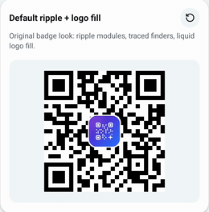
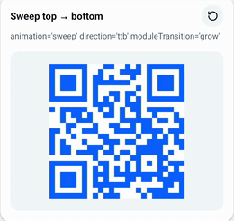
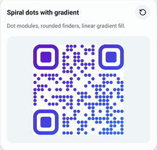
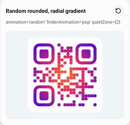
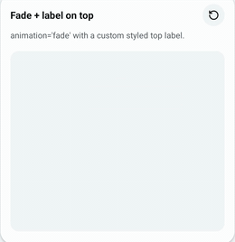
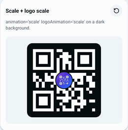
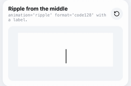
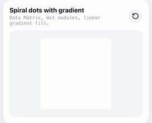
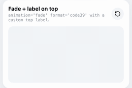
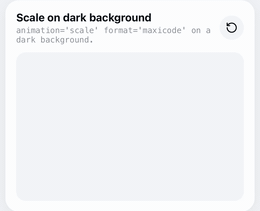

# react-native-animated-codes

A user-friendly yet highly customizable animated QR code and barcode generator for React Native (Android + iOS).

- `AnimatedQRCode`: QR code with finder pattern animations, optional logo and label
- `AnimatedBarcode`: **110 formats** (every monochrome symbology [bwip-js](https://github.com/metafloor/bwip-js) encodes): EAN / UPC / ISBN, Code 128, GS1-128, Code 39 / 93, ITF / ITF-14, Codabar, MSI, GS1 DataBar, postal (USPS IMb, POSTNET, Royal Mail, Australia Post, KIX, Japan Post), Data Matrix, PDF417 / MicroPDF417, Aztec, QR / Micro QR, Han Xin, DotCode, MaxiCode, Code One, composites and more
- Animation presets (`ripple`, `sweep`, `spiral`, `random`, `fade`, `scale`, `none`), custom dot order, custom easing, per-phase timeline, or drive it yourself with a `progress` shared value
- Imperative `play()` / `reset()` / `complete()`, `loop`, `autoPlay`, and respects the OS "reduce motion" setting
- Square, rounded or circle dots, square or rounded finder patterns, solid colors or linear / radial gradients
- Optional logo (image or any custom element) and label above or below the code

> Upgrading from an earlier version? Props were renamed, see [MIGRATION.md](MIGRATION.md).

Behind the scenes:

- Codes are drawn with [`react-native-svg`](https://github.com/software-mansion/react-native-svg).
- Animations run on the UI thread with [`react-native-reanimated`](https://github.com/software-mansion/react-native-reanimated).
- QR codes are encoded with [`qrcode`](https://www.npmjs.com/package/qrcode) and barcodes with [`bwip-js`](https://www.npmjs.com/package/bwip-js). Both are installed automatically.
- Pure JS, no native code of its own.

## Preview

### QR code

| Ripple + logo fill | Sweep top → bottom | Spiral dots + gradient |
|:---:|:---:|:---:|
|  |  |  |
| **Random + radial gradient** | **Fade + top label** | **Scale on dark background** |
|  |  |  |

### Barcode

| Ripple from the middle | Sweep, bars grow up | Spiral dots + gradient |
|:---:|:---:|:---:|
|  |  |  |
| **Random + radial gradient** | **Fade + top label** | **Scale on dark background** |
|  |  |  |

All previews are recorded from the [example app](#example-app).

## Installation

```sh
npm i react-native-animated-codes react-native-svg react-native-reanimated
cd ios && pod install && cd ..
```
> Requirements:
> - React `>= 18`
> - React Native `>= 0.72`
> - `react-native-svg` `>= 13`
> - `react-native-reanimated` `>= 3.6.0`
> - `react-native-worklets` (Reanimated 4 only)

### `react-native-svg` and `react-native-reanimated` configuration

This library renders with `react-native-svg` and animates with `react-native-reanimated`. Both are peer dependencies, so they must be installed in your app.

- Already have them in your app? Only install `react-native-animated-codes` and keep your existing setup.
- Using **Reanimated 4**? Also install worklets:

```sh
npm i react-native-worklets
```

Please refer [react-native-svg](https://www.npmjs.com/package/react-native-svg) and [react-native-reanimated](https://www.npmjs.com/package/react-native-reanimated) for installation and uses.

### Need to add the Babel plugin

Add the plugin as the **last** item of `plugins` in `babel.config.js`:

```js
// babel.config.js
module.exports = {
  presets: ['module:@react-native/babel-preset'],
  plugins: [
    // ...other plugins
    'react-native-worklets/plugin', // Reanimated 4 (must be last)
    // 'react-native-reanimated/plugin', // Reanimated 3 (must be last)
  ],
};
```

Babel and native changes need a fresh build:

```sh
npx react-native start --reset-cache
npx react-native run-ios      # or run-android
```

### Expo

Use `npx expo install react-native-animated-codes react-native-svg react-native-reanimated` (plus `react-native-worklets` for Reanimated 4). `babel-preset-expo` already adds the Reanimated / worklets plugin, so the Babel step above is not needed.

## Uses

### Basic

```jsx
import React from 'react';
import { View } from 'react-native';
import AnimatedQRCode, { AnimatedBarcode } from 'react-native-animated-codes';

export default function App() {
  return (
    <View style={{ flex: 1, alignItems: 'center', justifyContent: 'center', gap: 32 }}>
      <AnimatedQRCode
        value="https://example.com"
        size={240}
        logo={require('./logo.png')}
        logoSize={56}
        logoBorderRadius={14}
        label="Scan me"
      />

      <AnimatedBarcode value="590123412345" format="ean13" />
    </View>
  );
}
```

Both components play their animation automatically when they mount.

### With size customization

Only `value` is required. Set the size with `size` (a square), or with `width` / `height` (the QR stays square and is centered in the box). Use `quietZone` (in dots) to add a white margin around the code, which helps scanners:

```jsx
<AnimatedQRCode value="hello" size={260} />
<AnimatedQRCode value="hello" width={320} height={240} />
<AnimatedQRCode value="hello" quietZone={2} />
```

### With style customization

```jsx
<AnimatedQRCode
  value="https://example.com"
  color="#1B1B3A"
  backgroundColor="#F5F5FF"
  borderRadius={16}
  dotShape="rounded"        // 'square' | 'rounded' | 'circle'
  dotScale={0.9}            // < 1 adds small gaps between dots
  finderShape="rounded"     // 'square' | 'rounded'
  finderColor="#E63946"
  finderInnerColor="#1B1B3A"
  finderBackgroundColor="#FFE5E8" // fills the gap between ring and center
  containerStyle={{ padding: 12, borderRadius: 20, backgroundColor: '#F5F5FF' }}
/>
```

Gradients replace `color` for dots and finders:

```jsx
<AnimatedQRCode
  value="hello"
  gradient={{ type: 'linear', colors: ['#6A11CB', '#2575FC'], start: { x: 0, y: 0 }, end: { x: 1, y: 1 } }}
/>

<AnimatedQRCode value="hello" gradient={{ type: 'radial', colors: ['#FF512F', '#DD2476'] }} />
```

> **Keep contrast high.** Dark dots on a light background scan best. Very light colors or inverted codes may not scan on every device.

### With logo

Pass any image source:

```jsx
<AnimatedQRCode
  value="https://example.com"
  errorCorrection="high"        // more error correction for the covered area
  logo={require('./logo.png')}  // or { uri: 'https://...' }
  logoSize={56}
  logoPadding={4}
  logoBorderRadius={12}
  logoBackgroundColor="#FFFFFF"
  logoAnimation="fill"          // 'fill' | 'fade' | 'scale' | 'none'
/>
```

Or render your own element (an SVG icon, a `View`, …):

```jsx
<AnimatedQRCode
  value="hello"
  renderLogo={(size) => <MyIcon width={size} height={size} />}
  logoAnimation="scale"
/>
```

The logo hides part of the code and error correction rebuilds the missing part. **For logos bigger than ~20% of the code, use `errorCorrection="quartile"` or `errorCorrection="high"`.** In development a warning is logged if the logo is too big for the chosen `errorCorrection`.

### With label

```jsx
<AnimatedQRCode
  value="hello"
  label="Scan to pay"
  labelPosition="bottom"   // 'top' | 'bottom'
  labelGap={12}
  labelStyle={{ fontSize: 16, fontWeight: '600', color: '#333' }}
/>
```

`label` can also be any React element (then `labelStyle` is ignored, style the element yourself):

```jsx
<AnimatedQRCode value="hello" label={<Text style={styles.custom}>Scan me 👋</Text>} />
```

Set `animateLabel={false}` to show the label without the fade / slide in.

### With animation customization

```jsx
<AnimatedQRCode value="hello" animation="sweep" direction="topToBottom" duration={1500} delay={200} />

// Looping loader
<AnimatedQRCode value="hello" animation="random" loop loopDelay={1500} />

// Gradient + dots
<AnimatedQRCode
  value="https://example.com"
  animation="spiral"
  dotShape="circle"
  dotScale={0.9}
  finderShape="rounded"
  gradient={{ type: 'linear', colors: ['#6A11CB', '#2575FC'], start: { x: 0, y: 0 }, end: { x: 1, y: 1 } }}
/>
```

Fine tune:

- `dotTransition`: `'pop'` (small overshoot) or `'grow'` (no overshoot)
- `finderAnimation`: `'trace'`, `'pop'` or `'none'`
- `duration` / `delay` in ms
- `loop` + `loopDelay` to repeat forever
- `timeline` to change when each phase starts and how long it lasts ([details](#timeline))

### With custom dot order

`getDotOrder` runs on the JS thread, once per dot, while the code is built. Return a number from `0` (first) to `1` (last). Define it outside the component or wrap it in `useCallback`, so the code data is not rebuilt on every render.

```jsx
const diagonal = ({ x, y }) => (x + y) / 2;

<AnimatedQRCode value="hello" getDotOrder={diagonal} timeline={{ dotSpread: 0.6, dotJitter: 0 }} />
```

### With custom easing

`easing` and `dotEasing` run on the UI thread, so they must be worklets (`Easing.*` functions already are).

```jsx
import { Easing } from 'react-native-reanimated';

const elastic = (t) => {
  'worklet';
  if (t === 0 || t === 1) return t;
  return Math.pow(2, -10 * t) * Math.sin((t * 10 - 0.75) * ((2 * Math.PI) / 3)) + 1;
};

<AnimatedQRCode value="hello" dotEasing={elastic} easing={Easing.inOut(Easing.quad)} />
```

The package also exports ready-made worklets: `easeOutCubic`, `easeInOutCubic`, `easeOutBack`.

### With external progress (gestures, scroll, steps)

```jsx
import { useSharedValue, withTiming } from 'react-native-reanimated';

const progress = useSharedValue(0);

<AnimatedQRCode value="hello" progress={progress} />

progress.value = withTiming(0.5); // drive it from steps, gestures or scroll
```

With `progress`, the internal timer, `autoPlay`, `loop`, `play()` and `complete()` are not used.

### With playback control

Turn off `autoPlay` and use a ref:

```tsx
import React, { useRef } from 'react';
import { Button } from 'react-native';
import AnimatedQRCode, { type AnimatedQRCodeRef } from 'react-native-animated-codes';

function Screen() {
  const ref = useRef<AnimatedQRCodeRef>(null);

  return (
    <>
      <AnimatedQRCode
        ref={ref}
        value="hello"
        autoPlay={false}
        onAnimationStart={() => console.log('started')}
        onAnimationComplete={() => console.log('done')}
      />
      <Button title="Play" onPress={() => ref.current?.play()} />
      <Button title="Reset" onPress={() => ref.current?.reset()} />
      <Button title="Finish" onPress={() => ref.current?.complete()} />
    </>
  );
}
```

The same ref works for `AnimatedBarcode` (`AnimatedBarcodeRef`).

### With error handling

Invalid values (empty string, text too long, wrong characters for a barcode format, …) never crash your app. The component renders only its background and calls `onError`:

```jsx
<AnimatedBarcode
  value={userInput}
  format="ean13"
  onError={(e) => setErrorMessage(e.message)}
/>
```

### Barcode

```jsx
import { AnimatedBarcode } from 'react-native-animated-codes';

<AnimatedBarcode value="590123412345" format="ean13" />
<AnimatedBarcode value="Hello 123" format="code128" width={320} height={110} barRadius={1} />
<AnimatedBarcode value="ABC-12345" format="code128" showValue={false} width={280} height={90} />
<AnimatedBarcode value="hello world" format="datamatrix" size={180} dotShape="rounded" animation="ripple" />
<AnimatedBarcode value="This is PDF417" format="pdf417" encoderOptions={{ columns: 2 }} width={300} height={120} />
```

- `format` picks the symbology (default `'code128'`). Every value is in the typed `BarcodeFormat` union, so your editor autocompletes it.
- `encoderOptions` passes encoder options (check digits, columns, error level, …).
- Linear barcodes show the value as text below the bars. Hide it with `showValue={false}`, or replace the text with `label`.
- Not sure what a format expects? `BARCODE_FORMATS` has a valid `sample` value and required `encoderOptions` for every format (see [Response](#response)).

## Customisation

### `<AnimatedQRCode />` props

#### Data & size

| Option | Type | Default | Description |
|---|---|---|---|
| value | `string` | (required) | Text to encode. |
| errorCorrection | `'low' \| 'medium' \| 'quartile' \| 'high'` | `'medium'` | Error correction level: how much of the code can be covered or damaged and still scan (about 7% / 15% / 25% / 30%). |
| size | `number` | `min(width, height)` or `200` | QR square side. |
| width / height | `number` | `size` | QR box, QR is centered inside. |
| quietZone | `number` (dots) | `0` | Margin inside the QR square. |

#### Style & color

| Option | Type | Default | Description |
|---|---|---|---|
| style | `ViewStyle` | (none) | Outer wrapper (QR + label). |
| containerStyle | `ViewStyle` | (none) | QR box (shadow, border, padding…). |
| borderRadius | `number` | `0` | Background corner radius. |
| color | `string` | `'#000000'` | Dot color. |
| backgroundColor | `string` | `'#FFFFFF'` | Background color. |
| gradient | `Gradient` | (none) | Overrides `color` for dots and finders. |
| finderColor | `string` | dot fill | Finder outer ring. |
| finderInnerColor | `string` | `finderColor` | Finder 3×3 center. |
| finderBackgroundColor | `string` | (none) | Fills the gap between the finder ring and center. Not drawn when unset. |
| dotShape | `'square' \| 'rounded' \| 'circle'` | `'square'` | Dot shape. |
| dotScale | `number` (0–1] | `1` | Below 1 adds gaps between dots. |
| finderShape | `'square' \| 'rounded'` | `'square'` | Finder pattern shape. |

#### Logo

| Option | Type | Default | Description |
|---|---|---|---|
| logo | `ImageSourcePropType` | (none) | Leave out for no logo. |
| renderLogo | `(size: number) => ReactNode` | (none) | Custom logo element instead of an image. |
| logoSize | `number` | `qrSize * 0.2` | Logo size. |
| logoPadding | `number` | `2` | Space around the logo. |
| logoBorderRadius | `number` | `0` | Logo corner radius. |
| logoBackgroundColor | `string` | `'transparent'` | Background behind the logo. |
| logoPlaceholderOpacity | `number` | `0.15` | Faded logo shown before the fill. |
| logoStyle | `ImageStyle` | (none) | Logo image style. |
| logoContainerStyle | `ViewStyle` | (none) | Logo container style. |
| logoAnimation | `'fill' \| 'fade' \| 'scale' \| 'none'` | `'fill'` | Logo animation. |

#### Label

| Option | Type | Default | Description |
|---|---|---|---|
| label | `string \| ReactNode` | (none) | Leave out for no label. |
| labelStyle | `TextStyle` | (none) | String labels only. |
| labelContainerStyle | `ViewStyle` | (none) | Label container style. |
| labelPosition | `'top' \| 'bottom'` | `'bottom'` | Label position. |
| labelGap | `number` | `12` | Space between code and label. |
| animateLabel | `boolean` | `true` | Fades and slides in. |

#### Animation

| Option | Type | Default | Description |
|---|---|---|---|
| animation | `'ripple' \| 'sweep' \| 'spiral' \| 'random' \| 'fade' \| 'scale' \| 'none'` | `'ripple'` | Preset (see table below). |
| direction | `'leftToRight' \| 'rightToLeft' \| 'topToBottom' \| 'bottomToTop'` | `'leftToRight'` | For `sweep`. |
| dotTransition | `'pop' \| 'grow'` | `'pop'` | `pop` overshoots, `grow` does not. |
| dotEasing | worklet `(t) => number` | (none) | Overrides `dotTransition`. |
| finderAnimation | `'trace' \| 'pop' \| 'none'` | `'trace'` | Finder pattern animation. |
| getDotOrder | `(ctx: DotContext) => number` | (none) | Custom order 0..1, overrides the preset. |
| timeline | `Partial<Timeline>` | `DEFAULT_TIMELINE` | Per-phase timing. |
| duration | `number` (ms) | `1200` | Animation duration. |
| delay | `number` (ms) | `350` | Delay before the animation starts. |
| easing | worklet `EasingFunction` | `Easing.linear` | Easing of the overall progress. |
| loop | `boolean` | `false` | Repeat forever. |
| loopDelay | `number` (ms) | `1000` | Hold time between loops. |
| autoPlay | `boolean` | `true` | `false` → call `ref.play()`. |
| respectReduceMotion | `boolean` | `true` | OS reduce motion → shows final code instantly. |
| progress | `SharedValue<number>` | (none) | Drive the animation yourself (0 → 1). |

#### Events & accessibility

| Option | Type | Default | Description |
|---|---|---|---|
| onAnimationStart | `() => void` | (none) | Called when the animation starts. |
| onAnimationComplete | `() => void` | (none) | Not fired with `loop` or external `progress`. |
| onError | `(error: Error) => void` | (none) | Invalid value / size; renders blank background. |
| testID, accessibilityLabel | `string` | label or `'QR code'` | Accessibility. |

### Animation presets

| Preset | Effect |
|---|---|
| `ripple` (QR default) | Dots appear from the center outward. |
| `sweep` (barcode default) | Dots appear in a line, direction set by `direction`: `'leftToRight' \| 'rightToLeft' \| 'topToBottom' \| 'bottomToTop'`. |
| `spiral` | Dots appear in a spiral. |
| `random` | Dots appear in random order. |
| `fade` | Whole code fades in. |
| `scale` | Whole code scales in. |
| `none` | Code is shown immediately. |

### Ref methods

| Method | Description |
|---|---|
| `play()` | Start (or restart) the animation. |
| `reset()` | Back to the empty state. |
| `complete()` | Jump to the finished code. |

### Timeline

All values are fractions of the overall progress (0 → 1). Pass only the fields you want to change.

| Key | Default | Description |
|---|---|---|
| dotStart | `0.08` | When the first dot starts. |
| dotSpread | `0.55` | How long dots keep starting. |
| dotJitter | `0.06` | Random offset per dot. |
| dotDuration | `0.18` | How long each dot animates. |
| finderStart | `0.42` | Finder ring start. |
| finderDuration | `0.3` | Finder ring duration. |
| finderCenterStart | `0.7` | Finder center start. |
| finderCenterDuration | `0.2` | Finder center duration. |
| finderStagger | `0.04` | Delay between the three finders. |
| logoStart | `0` | Logo animation start. |
| logoDuration | `0.85` | Logo animation duration. |
| labelStart | `0.75` | Label animation start. |
| labelDuration | `0.25` | Label animation duration. |

### `<AnimatedBarcode />` props

Animation, timing, events, ref (`play` / `reset` / `complete`), `gradient`, `label*`, `testID` and `accessibilityLabel` work as in `AnimatedQRCode`. Differences:

| Option | Type | Default | Description |
|---|---|---|---|
| value | `string` | (required) | Must be valid for the format, otherwise `onError` fires and only the background renders. |
| format | `BarcodeFormat` | `'code128'` | Any bwip-js `bcid` (typed union of all 110). |
| encoderOptions | `Record<string, string \| number \| boolean>` | (none) | Passed to the encoder: `includecheck`, `parse`, `parsefnc`, `eclevel`, `columns`, `rows`, `version`, `mode`… Drawing-only options (`includetext`, `showborder`, `height`…) are ignored. |
| size | `number` | (none) | 2D: side of the square box. Linear: box width. |
| width / height | `number` | see [Barcode kinds](#barcode-kinds) | Linear bars stretch to the box, 2D symbols keep their aspect and are centered. |
| quietZone | `number` (dots, bar widths for linear) | see [Barcode kinds](#barcode-kinds) | Linear: left / right, top / bottom use at most 10% of the height. |
| containerStyle | `ViewStyle` | (none) | Barcode box (shadow, border…). |
| borderRadius | `number` | `0` | Background corner radius. |
| color / backgroundColor | `string` | `'#000000'` / `'#FFFFFF'` | Bar / dot and background colors. |
| bullseyeColor | `string` | dot fill | MaxiCode only. |
| dotShape | `'square' \| 'rounded' \| 'circle'` | `'square'` (`'circle'` for DotCode) | 2D only. |
| dotScale | `number` (0–1] | `1` | 2D / MaxiCode only, bars keep their width so the code stays readable. |
| barRadius | `number` | `0` | Linear only, rounded bar corners. |
| showValue | `boolean` | `true` for linear | Shows `value` as the label (monospace), `label` overrides the text. |
| labelGap | `number` | `8` | Space between code and label. |
| animation | `AnimationType` | `'sweep'` | `ripple` grows from the middle, `spiral` / `random` / `fade` / `scale` / `none` as for QR. |
| dotTransition | `'pop' \| 'grow'` | `'grow'` linear, `'pop'` 2D | Linear: `grow` rises from the bar bottom, `pop` opens from the middle. |
| timeline | `Partial<Timeline>` | `DEFAULT_TIMELINE` | `dot*` for bars / dots, `finder*` for the MaxiCode bullseye, `label*` for the text. |

### Barcode kinds

Three kinds of symbol are rendered, picked from `format`. `getBarcodeKind(format)` returns the kind of a format.

| Kind | Formats | Elements | Default box | Default quiet zone |
|---|---|---|---|---|
| `linear` | EAN, UPC, Code 128, Code 39, ITF, postal 4-state… | bars (postal bars keep their partial heights) | `300 × 120` (`height` = 40% of `width`) | 10 bar widths left / right |
| `matrix` | Data Matrix, PDF417, Aztec, QR, DotCode, stacked DataBar, composites… | dots | `200 × 200` | 2 dots |
| `maxicode` | MaxiCode | hexagons + bullseye | `200 × 200` | 1 hexagon |

### Notes & limitations

- `getDotOrder` receives `{ row, column, count, x, y }`: for linear codes `row` is `0`, `column` is the bar index and `x` / `y` the bar center (0..1).
- `AnimatedBarcode` has no `finderAnimation`, logo props or `errorCorrection` (use `encoderOptions={{ eclevel: 'H' }}` for 2D formats that support it).
- Changing `value`, size, `errorCorrection`, `quietZone`, `animation`, `direction`, `duration`, `delay`, `loop`, `loopDelay` or `timeline` restarts the animation. Changing colors, gradient, styles, label or logo does not.
- **Bundle size:** bwip-js ships the full Barcode Writer in Pure PostScript encoder, about 2 MB of JS before minification. It is bundled even if you only use `AnimatedQRCode`.
- **Human readable text:** linear barcodes show the value as one centered line. EAN / UPC style digits split around the guard bars are not drawn.

## Response

The components render the code and report back through callbacks:

- `onAnimationStart()`: the animation started.
- `onAnimationComplete()`: the animation finished (not fired with `loop` or external `progress`).
- `onError(error: Error)`: the value or size is invalid. Only the background renders.

`BARCODE_FORMATS` lists every supported barcode format:

```ts
type BarcodeFormatInfo = {
  format: BarcodeFormat;   // e.g. 'code39'
  name: string;            // e.g. 'Code 39'
  kind: 'linear' | 'matrix' | 'maxicode';
  sample: string;          // a valid value for this format
  encoderOptions?: BarcodeEncoderOptions; // encoder options the format needs
};
```

```js
import { BARCODE_FORMATS } from 'react-native-animated-codes';

const info = BARCODE_FORMATS.find((f) => f.format === 'code39');
// { format: 'code39', name: 'Code 39', kind: 'linear', sample: 'THIS IS CODE 39', encoderOptions: { includecheck: true, ... } }
```

Everything the package exports:

```ts
import AnimatedQRCode, {          // default export = AnimatedQRCode
  AnimatedQRCode,
  AnimatedBarcode,
  getBarcodeKind,
  BARCODE_FORMATS,
  DEFAULT_TIMELINE,
  easeOutCubic, easeInOutCubic, easeOutBack,
} from 'react-native-animated-codes';

import type {
  AnimatedQRCodeProps, AnimatedQRCodeRef,
  AnimatedBarcodeProps, AnimatedBarcodeRef,
  AnimationType, BarcodeFormat, BarcodeFormatInfo, BarcodeKind, BarcodeEncoderOptions,
  ErrorCorrectionLevel, FinderAnimation, FinderShape, Gradient, LabelPosition,
  LogoAnimation, DotContext, DotOrder, DotShape, DotTransition,
  Point, SweepDirection, Timeline,
} from 'react-native-animated-codes';
```

See `src/types.ts` for the full props and types.

## Troubleshooting

### The code does not animate / app crashes with a worklet or Reanimated error

- The Babel plugin is missing or not last. Check [Need to add the Babel plugin](#need-to-add-the-babel-plugin), then restart Metro with `--reset-cache` and rebuild the app.

### Getting `Unable to resolve module bwip-js/generic`

- The package imports `bwip-js/generic` through package `exports`. Metro supports this by default since React Native 0.79. On older versions, enable it in `metro.config.js`:

```js
const config = {
  resolver: { unstable_enablePackageExports: true },
};
```

### Jest fails with `Cannot find module 'bwip-js/generic'`

- `bwip-js/generic` is exported for ESM `import` only, so Jest's CommonJS resolver cannot find it. Point it at the Node build of bwip-js, which has the same encoder:

```js
// jest.config.js
moduleNameMapper: {
  '^bwip-js/generic$': '<rootDir>/node_modules/bwip-js/dist/bwip-js-node.js',
},
```

### Only a blank box is shown

- The value is not valid for the format (or the size is invalid). Add `onError={(e) => console.warn(e.message)}` to see why.
- Use `BARCODE_FORMATS` to get a working sample value and the encoder options a format needs.

### The QR code with a logo does not scan

- Increase error correction (`errorCorrection="quartile"` or `errorCorrection="high"`), make the logo smaller, or add `quietZone={2}`.

### The barcode does not scan

- Keep the quiet zone, use high contrast, and give the code enough `width` so the narrowest bar is at least 1 pixel wide (long Code 128 values need a wide box).

### Animation is slow on low-end Android with long values

- Very long values produce dense codes (thousands of dots). Prefer `animation="fade"` or `"scale"` for them.

### The animation restarts on every render

- Inline `getDotOrder` functions are new each render. Define them outside the component or wrap them in `useCallback`. (Inline `timeline` / `encoderOptions` objects are fine, they are compared by content.)

## Example app

The repo includes a full example app:

```sh
cd ExampleApp
npm install
cd ios && bundle install && bundle exec pod install && cd ..
npm run ios      # or: npm run android
```

It contains:

- **Playground**: toggle every QR prop live
- **Showcase**: presets, custom orders, external progress, manual playback
- **Barcodes**: playground for every format and option
- **Gallery**: renders all 110 formats

## License

MIT
